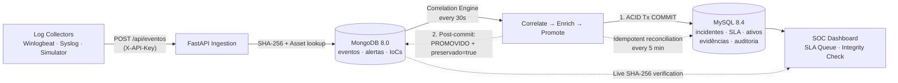

<div align="center">

# IOSEPHVS · *custos datorum*

**SOC-as-a-Service MVP for small businesses and municipalities**

Ingests security logs, correlates attacks in real time, opens SLA-tracked incidents, and enforces a cryptographic chain of custody for digital evidence.

🌐 **English** · [Português (Brasil)](./README.pt-BR.md)

[](https://github.com/joaoheliodev/Iosephus/actions/workflows/testes.yml)


</div>

---

## Table of Contents

- [Architecture & Core Principle](#architecture--core-principle)
- [Key Features](#key-features)
- [Security & Compliance Design](#security--compliance-design)
- [Quick Start (Local)](#quick-start-local)
- [Demo Scenario: Vale Verde](#demo-scenario-vale-verde)
- [API Overview](#api-overview)
- [CLI Administration](#cli-administration)
- [Deploying to AWS (CDK)](#deploying-to-aws-cdk)
- [Testing & CI](#testing--ci)
- [Project Structure](#project-structure)
- [Roadmap](#roadmap)

---

## Architecture & Core Principle

Iosephus is built around a single polyglot persistence principle:

> **MongoDB stores raw facts; MySQL stores decisions.**
> The two databases are linked exclusively through `ObjectId` + `SHA-256` hash—never cross-database foreign keys.



### Cross-Database Consistency Guarantee

When an alert is promoted to an incident, Iosephus enforces a strict write order:

1. **MySQL Transaction (`COMMIT`)**: Atomically inserts the incident (computing SLA deadlines from `politicas_sla`), links the target asset (`incidente_ativo`), records every evidence `ObjectId` + `SHA-256` (`incidente_evidencia`), and appends the initial audit record (`incidente_historico`).
2. **MongoDB Post-Commit Update**: Only *after* the MySQL commit succeeds does MongoDB mark the alert `PROMOVIDO` and flip all referenced events to `preservado: true` (exempting them from the 180-day TTL index).
3. **Idempotent Reconciliation (every 5 min)**: If a crash happens between steps 1 and 2, the reconciliation job repairs any half-completed promotion. A `UNIQUE` constraint on `incidentes.alerta_origem_id` guarantees no alert can ever be promoted twice.

---

## Key Features

- **Log Ingestion (`POST /api/eventos`)**
  - Authenticated via `X-API-Key` header, accepting batches of up to 1,000 events (`autenticacao`, `firewall`, `ids`, `edr`, `dns`).
  - Computes `SHA-256` over the untouched raw log (`bruto`) on arrival.
  - Automatically resolves `ativo_id` from the MySQL asset inventory using `(organizacao_id, ip_destino)`.
  - Persists events in MongoDB with `$jsonSchema` validation and a **180-day partial TTL** (`preservado: false`).

- **Correlation & Threat Enrichment Engine**
  - Runs every 30 seconds in a background worker (`motor.py`), loading active rules dynamically from MySQL `regras_deteccao`.
  - Ships with Rule #15 (`forca_bruta_com_sucesso`, MITRE ATT&CK `T1110.001`): detects RDP brute-force (≥20 Windows Event `4625` failures) followed by a successful logon (`4624`) from the same IP against the same asset within a 10-minute window.
  - Deduplicates alerts inside the rule window and enriches them against MongoDB `indicadores_ameaca` (IoCs), escalating severity to `CRITICA` on known malicious IPs.
  - Caps evidence references per alert at 100 events to stay safely within MongoDB's 16 MB document limit.

- **Incident Management & SLA Enforcement**
  - Refuses to open an incident if the client lacks an SLA policy for that severity (marks the alert `SEM_SLA` instead of creating untracked work).
  - Cross-references attacked assets against open high/critical vulnerabilities (`ativo_vulnerabilidade` + `vulnerabilidades` with CVSS-derived severity).
  - Follows a strictly forward-only **NIST SP 800-61** lifecycle:
    `ABERTO` → `EM_ANALISE` → `CONTIDO` → `ERRADICADO` → `RECUPERADO` → `ENCERRADO`.
  - Uses optimistic concurrency on incident claiming (`POST /api/incidentes/{id}/assumir`), returning `409 Conflict` if two analysts claim the same ticket simultaneously.

- **SOC Dashboard (Zero-Dependency Frontend)**
  - Pure HTML, CSS, and vanilla JS with auto-refresh every 30 seconds and real-time KPIs (*Open*, *Critical*, *Unassigned*, *SLA Breached*).
  - Queue sorted by SLA resolution deadline.
  - Live evidence integrity verification on every incident view: recomputes `SHA-256(bruto)` from MongoDB and flags each event as `INTEGRA`, `ADULTERADA` (tampered), or `AUSENTE` (missing).

---

## Security & Compliance Design

| Layer | Implementation |
|---|---|
| **Authentication** | Argon2id password hashing with constant-time dummy verification (prevents user enumeration); HS256 JWT (8-hour expiration); `SERVICO` accounts blocked from dashboard login. |
| **RBAC & Multi-Tenancy** | 5 roles (`ADMIN`, `ANALISTA_N1`, `ANALISTA_N2`, `GESTOR_CLIENTE`, `SERVICO`) with granular permissions. Client managers see only their own organization; cross-tenant lookups return `404` to avoid existence leaks. |
| **Database Immutability** | The application MySQL user (`app_soc`) has **least-privilege `GRANT`s**: only `SELECT` and `INSERT` on `incidente_evidencia` and `incidente_historico`—even a compromised API cannot alter or delete chain-of-custody records. |
| **Web Hardening** | DOM rendered exclusively via `textContent` (never `innerHTML`), strict `Content-Security-Policy`, `X-Frame-Options: DENY`, `X-Content-Type-Options: nosniff`, `Referrer-Policy: no-referrer`. |
| **Container Isolation** | API runs as non-root user (`uid 10001`). MySQL and MongoDB publish no host ports and communicate strictly over Compose's internal network. |
| **LGPD / Regulatory Readiness** | Schema includes `pequeno_porte_lgpd` (double ANPD notification windows), `ciencia_dados_pessoais_em`, `comunicado_anpd_em`, alphanumeric `CHAR(14)` CNPJ support, and `mfa_habilitado`. |

---

## Quick Start (Local)

**Prerequisites:** Docker with the Compose plugin and Python 3.9+.

```bash
# 1. Generate random secrets (.env with restricted permissions)
./scripts/gerar_env.sh > .env && chmod 600 .env

# 2. Start MySQL 8.4, MongoDB 8.0, and the FastAPI app (auto-initializes schemas & demo seed)
docker compose up -d --build

# 3. Set a password for a demo analyst (minimum 12 characters)
docker compose exec api python -m app.cli definir-senha analista2@iosephus.local

# 4. Run the Vale Verde attack simulation
INGEST_API_KEY=$(grep INGEST_API_KEY .env | cut -d= -f2) python3 scripts/simular_ataque.py
```

Open **http://127.0.0.1:8000** and sign in as `analista2@iosephus.local`. The incident appears within 30 seconds. Interactive OpenAPI documentation is available at **http://127.0.0.1:8000/api/docs**.

### Demo Users

All seeded accounts start **locked** (`senha_hash = '!'`) until you set a password via the CLI:

| Email | Role | Permissions |
|---|---|---|
| `admin@iosephus.local` | `ADMIN` | Full access (manage users, rules, incidents) |
| `analista2@iosephus.local`, `analista3@iosephus.local` | `ANALISTA_N2` | Claim incidents, advance status, attach evidence, edit rules |
| `ti@valeverde.example` | `GESTOR_CLIENTE` | Read-only view scoped to *Prefeitura de Vale Verde* |
| `motor@iosephus.local` | `SERVICO` | Internal automation account (dashboard login blocked) |

### Database Shell & Reset

```bash
# Connect to MySQL (use MYSQL_ROOT_PASSWORD from .env)
docker compose exec mysql mysql -uroot -p iosephus

# Connect to MongoDB (use MONGO_ROOT_PASSWORD from .env)
docker compose exec mongo mongosh -u root -p --authenticationDatabase admin iosephus

# Wipe all containers and volumes
docker compose down -v
```

---

## Demo Scenario: Vale Verde

Running `scripts/simular_ataque.py` replays a realistic municipal SOC scenario against **Prefeitura de Vale Verde** (`organizacao_id = 7`), sending **45 events** in a single batch:

1. **Reconnaissance & Exposure**: Suricata IDS logs an SSH scan (`sid: 2001219`) and pfSense logs an exposed NAT rule (`3389 → SRV-ARQUIVOS`) from attacker IP `203.0.113.45` (RFC 5737 documentation range).
2. **Brute Force**: 37 failed Windows RDP logons (Event `4625`) against `SRV-ARQUIVOS` (`10.20.0.15`), one every 15 seconds.
3. **Benign Noise**: 5 mistyped password attempts by employee `joana.silva` from `10.20.0.88` (ignored by the correlation engine).
4. **Compromise**: 1 successful RDP logon (Event `4624`) by `203.0.113.45` as `administrador`.

Within 30 seconds, the engine:
- Correlates the 38 attack events via **Rule #15 (`T1110.001`)** and ignores the employee noise.
- Matches `203.0.113.45` against the seeded **AbuseIPDB IoC** (`rdp-bruteforce`, `botnet`, confidence 90) and confirms `CRITICA` severity.
- Promotes the alert to a MySQL incident with **15 min response / 240 min resolution SLA**.
- Surfaces the open critical vulnerability **CVE-2019-0708 (BlueKeep, CVSS 9.8)** on `SRV-ARQUIVOS` inside the incident detail panel.
- Preserves all 38 evidence documents in MongoDB (`preservado: true`) with live `SHA-256` integrity verification.

---

## API Overview

| Method | Endpoint | Auth | Description |
|---|---|---|---|
| `GET` | `/api/saude` | Public | Health check for MySQL and MongoDB connectivity |
| `POST` | `/api/auth/login` | Public | Authenticate with email/password and receive a JWT |
| `GET` | `/api/auth/eu` | Bearer JWT | Return current user profile and RBAC permissions |
| `POST` | `/api/eventos` | `X-API-Key` | Ingest a batch of 1–1,000 raw security events |
| `GET` | `/api/incidentes` | Bearer JWT (`incidente.ler`) | List incidents ordered by SLA deadline (`?abertos=true\|false`) |
| `GET` | `/api/incidentes/resumo` | Bearer JWT (`incidente.ler`) | Return dashboard KPI counters |
| `GET` | `/api/incidentes/{id}` | Bearer JWT (`incidente.ler`) | Incident detail, assets, open CVEs, verified evidence, and audit log |
| `POST` | `/api/incidentes/{id}/assumir` | Bearer JWT (`incidente.alterar_status`) | Claim an open incident (optimistic lock) |
| `POST` | `/api/incidentes/{id}/status` | Bearer JWT (`incidente.alterar_status`) | Advance NIST status with mandatory audit comment |

---

## CLI Administration

Run inside the API container (`docker compose exec api ...`):

```bash
python -m app.cli definir-senha <email>   # Set or rotate a user's Argon2id password (≥12 chars)
python -m app.cli correlacionar           # Trigger one correlation & promotion cycle immediately
python -m app.cli reconciliar             # Trigger one idempotent reconciliation cycle immediately
```

---

## Deploying to AWS (CDK)

Everything deploys onto a single ARM64 **`t4g.small`** EC2 instance (2 GB RAM + 2 GB swap) running Docker Compose, defined in Python with AWS CDK v2 (`infra/`).

- **Zero secrets in Git/CDK**: Code is uploaded as an S3 asset (works with private repos). The instance downloads the package on first boot and generates its own `.env` (`chmod 600`).
- **Closed by default**: Zero inbound ports open to the internet. Access the dashboard and shell via **AWS Systems Manager (SSM) Session Manager** (no SSH, no key pairs, encrypted GP3 disk, IMDSv2 required).
- **Non-destructive updates**: `user_data_causes_replacement=False` preserves the EC2 instance and Docker volumes across code deployments.

```bash
cd infra
python -m venv .venv && source .venv/bin/activate
pip install -r requirements.txt

npx aws-cdk@2 bootstrap                                  # First time per AWS account/region
npx aws-cdk@2 deploy -c email_alerta=YOU@EMAIL.COM
```

The stack outputs ready-to-run commands:

| Output | Purpose |
|---|---|
| `TunelDashboard` | Port-forwards the dashboard to `http://localhost:8000` over SSM (no public port) |
| `Terminal` | Interactive shell via SSM Session Manager |
| `Atualizar` | Pulls the latest S3 code asset after a new `cdk deploy` without losing database volumes |
| `Ligar` / `Desligar` | Start or stop the EC2 instance to save costs when idle |

> **Note:** `TunelDashboard` and `Terminal` require the AWS [`session-manager-plugin`](https://docs.aws.amazon.com/systems-manager/latest/userguide/session-manager-working-with-install-plugin.html).

On first deployment, set an analyst password via the SSM terminal:

```bash
sudo -i
cd /opt/iosephus/app && docker compose exec api python -m app.cli definir-senha analista2@iosephus.local
grep INGEST_API_KEY /opt/iosephus/.env   # Copy collector API key
```

To optionally expose HTTP port 80 strictly to your own IP (prefer the SSM tunnel; add a domain + TLS reverse proxy such as Caddy for production exposure):

```bash
npx aws-cdk@2 deploy -c email_alerta=YOU@EMAIL.COM -c acesso_cidr=$(curl -s https://checkip.amazonaws.com)/32
```

### Estimated Cost & Budget Circuit Breaker

| Resource | Est. USD/month (`us-east-1`, 24/7) |
|---|---|
| EC2 `t4g.small` (ARM64) | ~$12.30 |
| EBS `gp3` 20 GB (encrypted) | ~$1.60 |
| Public IPv4 address | ~$3.60 |
| VPC (no NAT Gateway), SSM, S3 asset | ~$0.00 |
| **Total** | **~$17.50/month** |

When stopped, the instance costs only the EBS disk (~$1.60/month). Passing `-c email_alerta=...` attaches an **AWS Budgets Action** that automatically stops the EC2 instance when actual spend reaches **90%** of the `iosephus-20usd` budget (override the budget name with `-c orcamento=NAME`; the budget must exist before deploying). Because AWS billing updates with a few hours' delay, treat this as a safety brake rather than an exact hard cap.

---

## Testing & CI

```bash
cd api && pip install -r requirements-dev.txt

# 1. Pure domain unit tests (SHA-256, NIST transitions, IoC severity, integrity states)
pytest

# 2. Full end-to-end integration tests against real MySQL 8.4 (real schema & GRANTs; mongomock for MongoDB)
MYSQL_APP_PASSWORD=teste ../scripts/criar_banco_teste.sh
IOSEPHUS_TESTE_MYSQL=1 pytest
```

GitHub Actions (`.github/workflows/testes.yml`) runs both suites automatically on every push and pull request against a live MySQL 8.4 service container, including a direct test verifying that `app_soc` receives MySQL error `1142` (`DELETE command denied`) when attempting to delete evidence.

---

## Project Structure

```text
.
├── api/
│   ├── Dockerfile                 # python:3.12-slim, non-root user (uid 10001), healthcheck
│   ├── requirements.txt           # FastAPI, Uvicorn, SQLAlchemy, PyMySQL, PyMongo, Argon2, PyJWT
│   ├── app/
│   │   ├── main.py                # FastAPI entrypoint, security headers, background engine loop
│   │   ├── config.py              # Pydantic Settings (.env / environment variables)
│   │   ├── db.py                  # MySQL (UTC) & MongoDB connections + row serializers
│   │   ├── dominio.py             # Pure business rules (SHA-256, NIST lifecycle, integrity)
│   │   ├── auth.py                # Argon2id login, HS256 JWT, RBAC, collector API key
│   │   ├── ingestao.py            # POST /api/eventos: hash, asset resolution, MongoDB write
│   │   ├── motor.py               # Correlation, atomic promotion (MySQL → MongoDB), reconciliation
│   │   ├── incidentes.py          # Queue, KPIs, detail + live integrity check, claim, status updates
│   │   ├── cli.py                 # Admin CLI (password setup, manual correlation/reconciliation)
│   │   └── static/                # Zero-dependency SOC dashboard (HTML/CSS/JS, strict CSP)
│   └── tests/
│       ├── test_dominio.py        # Domain unit tests
│       └── test_fluxo.py          # Full E2E + tampering + optimistic locking + GRANT enforcement tests
├── db/
│   ├── mysql/
│   │   ├── 01_schema.sql          # 14 InnoDB tables (RBAC, SLA, assets, CVEs, incidents, custody, audit)
│   │   ├── 02_usuario_app.sh      # Least-privilege app_soc user (append-only evidence & history)
│   │   └── 03_seed_demo.sql       # Vale Verde demo dataset (orgs, SLAs, users, BlueKeep CVE, Rule #15)
│   └── mongo/
│       └── 01_init.js             # $jsonSchema, partial 180-day TTL, indexes, time-series, demo IoC
├── infra/
│   ├── app.py                     # AWS CDK v2 entrypoint
│   └── iosephus_infra/stack.py    # VPC (no NAT), ARM64 EC2, SSM, S3 asset, Budgets auto-stop action
├── scripts/
│   ├── gerar_env.sh               # Random hex secrets generator
│   ├── simular_ataque.py          # Vale Verde 45-event attack simulator (stdlib only)
│   └── criar_banco_teste.sh       # Local MySQL test database initializer
├── .github/workflows/testes.yml   # GitHub Actions CI pipeline (MySQL 8.4 + pytest)
└── docker-compose.yml             # MySQL 8.4 + MongoDB 8.0 + FastAPI orchestration
```

---

## Roadmap

- [ ] TLS termination with a custom domain (e.g., Caddy reverse proxy)
- [ ] Production log collectors (Winlogbeat / Fluent Bit forwarding to `/api/eventos`)
- [ ] Per-client ingestion API keys
- [ ] MFA for dashboard login (schema already includes `usuarios.mfa_habilitado`)
- [ ] Automated volume backups to Amazon S3
- [ ] Additional detection rule types in `motor.DETECTORES`
- [ ] Automated vulnerability scan ingestion (`varreduras`) and network telemetry (`telemetria_rede`)
