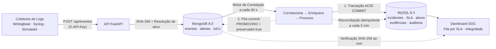

<div align="center">

# IOSEPHVS · *custos datorum*

**MVP de SOC-as-a-Service para pequenas empresas e prefeituras**

Recebe logs de segurança, correlaciona ataques em tempo real, abre incidentes com prazo de SLA e mantém cadeia de custódia criptográfica das evidências digitais.

🌐 [English](./README.md) · **Português (Brasil)**

[](https://github.com/joaoheliodev/Iosephus/actions/workflows/testes.yml)


</div>

---

## Sumário

- [Arquitetura e Princípio Central](#arquitetura-e-princípio-central)
- [O que o MVP faz](#o-que-o-mvp-faz)
- [Segurança e Conformidade](#segurança-e-conformidade)
- [Rodar na sua máquina](#rodar-na-sua-máquina)
- [Cenário de Demonstração: Vale Verde](#cenário-de-demonstração-vale-verde)
- [Visão Geral da API](#visão-geral-da-api)
- [CLI de Administração](#cli-de-administração)
- [Subir na AWS (CDK)](#subir-na-aws-cdk)
- [Testes e CI](#testes-e-ci)
- [Estrutura do Projeto](#estrutura-do-projeto)
- [Próximos Passos](#próximos-passos)

---

## Arquitetura e Princípio Central

O Iosephus parte de um princípio claro de persistência poliglota:

> **MongoDB guarda o fato bruto; MySQL guarda a decisão.**
> Os dois bancos se ligam exclusivamente por `ObjectId` + hash `SHA-256`, nunca por chave estrangeira entre bancos.



### Garantia de Consistência entre Bancos

Quando um alerta é promovido a incidente, o motor impõe uma ordem rígida de escrita:

1. **Transação no MySQL (`COMMIT`)**: Grava atomicamente o incidente (calculando os prazos a partir de `politicas_sla`), vincula o ativo alvo (`incidente_ativo`), registra o `ObjectId` + `SHA-256` de cada evidência (`incidente_evidencia`) e grava a entrada inicial na trilha de auditoria (`incidente_historico`).
2. **Pós-commit no MongoDB**: Somente *após* o `COMMIT` no MySQL o alerta é marcado como `PROMOVIDO` e os eventos vinculados recebem `preservado: true` (saindo do índice de TTL de 180 dias).
3. **Reconciliação Idempotente (a cada 5 min)**: Se ocorrer falha entre os passos 1 e 2, o reconciliador conclui o que ficou pela metade. A restrição `UNIQUE` em `incidentes.alerta_origem_id` impede que o mesmo alerta gere dois incidentes.

---

## O que o MVP faz

- **Ingestão de Logs (`POST /api/eventos`)**
  - Autenticada pelo cabeçalho `X-API-Key`, aceitando lotes de 1 a 1.000 eventos (`autenticacao`, `firewall`, `ids`, `edr`, `dns`).
  - Calcula o `SHA-256` do log bruto (`bruto`) no momento da chegada.
  - Descobre automaticamente o `ativo_id` no inventário do MySQL a partir de `(organizacao_id, ip_destino)`.
  - Persiste no MongoDB com validação `$jsonSchema` e **TTL parcial de 180 dias** (`preservado: false`).

- **Motor de Correlação e Inteligência de Ameaças**
  - Executa a cada 30 segundos em thread dedicada (`motor.py`), carregando as regras ativas diretamente de `regras_deteccao` no MySQL.
  - Inclui a Regra 15 (`forca_bruta_com_sucesso`, MITRE ATT&CK `T1110.001`): detecta força bruta RDP (≥20 falhas Windows Event `4625`) seguida de logon bem-sucedido (`4624`) do mesmo IP contra o mesmo ativo numa janela de 10 minutos.
  - Deduplica alertas dentro da janela da regra e enriquece com `indicadores_ameaca` (IoCs) do MongoDB, elevando a severidade para `CRITICA` quando o IP atacante já é conhecido como malicioso.
  - Limita a lista de referências em cada alerta a 100 eventos para respeitar com folga o limite de 16 MB por documento do MongoDB.

- **Gestão de Incidentes e SLA**
  - Impede a criação de incidentes para clientes sem política de SLA cadastrada para aquela severidade (o alerta recebe status `SEM_SLA`).
  - Cruza automaticamente o ativo atacado com vulnerabilidades abertas de severidade alta/crítica (`ativo_vulnerabilidade` + `vulnerabilidades`, cuja severidade é derivada por coluna gerada do CVSS).
  - Impõe o ciclo de vida **NIST SP 800-61** estritamente para frente:
    `ABERTO` → `EM_ANALISE` → `CONTIDO` → `ERRADICADO` → `RECUPERADO` → `ENCERRADO`.
  - "Assumir" incidente usa concorrência otimista (`POST /api/incidentes/{id}/assumir`), retornando `409 Conflict` se dois analistas clicarem ao mesmo tempo.

- **Dashboard SOC (Sem Frameworks Pesados)**
  - HTML, CSS e JavaScript puro com atualização automática a cada 30 segundos e KPIs em tempo real (*Abertos*, *Críticos*, *Sem analista*, *SLA estourado*).
  - Fila ordenada pelo prazo de resolução do SLA.
  - Verificação de integridade das evidências ao vivo em cada abertura de incidente: recalcula o `SHA-256(bruto)` vindo do MongoDB e classifica cada evento como `INTEGRA`, `ADULTERADA` ou `AUSENTE`.

---

## Segurança e Conformidade

| Camada | Implementação |
|---|---|
| **Autenticação** | Senhas com **Argon2id** e verificação com hash falso em tempo constante (evita enumeração de e-mails); JWT `HS256` (validade de 8 h); contas `SERVICO` bloqueadas no login do dashboard. |
| **RBAC e Multi-tenancy** | 5 perfis (`ADMIN`, `ANALISTA_N1`, `ANALISTA_N2`, `GESTOR_CLIENTE`, `SERVICO`) com permissões granulares. O gestor do cliente vê apenas a própria organização; consultas a incidentes de terceiros retornam `404` para não revelar existência. |
| **Imutabilidade no Banco** | O usuário da aplicação no MySQL (`app_soc`) opera com **privilégio mínimo (`GRANT`)**: possui apenas `SELECT` e `INSERT` em `incidente_evidencia` e `incidente_historico` — nem a API comprometida consegue apagar ou alterar a cadeia de custódia. |
| **Endurecimento Web** | Toda renderização usa `textContent` (nunca `innerHTML`), `Content-Security-Policy` restrita, `X-Frame-Options: DENY`, `X-Content-Type-Options: nosniff` e `Referrer-Policy: no-referrer`. |
| **Isolamento de Containers** | A API roda como usuário sem privilégios (`uid 10001`). MySQL e MongoDB não expõem portas no host e trafegam apenas na rede interna do Docker Compose. |
| **Preparação para LGPD** | O schema já modela `pequeno_porte_lgpd` (prazos em dobro da ANPD), `ciencia_dados_pessoais_em`, `comunicado_anpd_em`, CNPJ alfanumérico (`CHAR(14)`) e `mfa_habilitado`. |

---

## Rodar na sua máquina

**Pré-requisitos:** Docker com o plugin Compose e Python 3.9+.

```bash
# 1. Gera segredos aleatórios (.env com permissão restrita)
./scripts/gerar_env.sh > .env && chmod 600 .env

# 2. Sobe MySQL 8.4, MongoDB 8.0 e API (1ª vez inicializa schemas e seed automaticamente)
docker compose up -d --build

# 3. Define a senha de um analista de demonstração (mínimo de 12 caracteres)
docker compose exec api python -m app.cli definir-senha analista2@iosephus.local

# 4. Simula o ataque contra a Prefeitura de Vale Verde
INGEST_API_KEY=$(grep INGEST_API_KEY .env | cut -d= -f2) python3 scripts/simular_ataque.py
```

Abra **http://127.0.0.1:8000** e entre como `analista2@iosephus.local`. O incidente aparece em até 30 segundos. A documentação interativa da API fica em **http://127.0.0.1:8000/api/docs**.

### Usuários de Demonstração

Todos começam **sem senha válida** (`senha_hash = '!'`) até que a senha seja definida via CLI:

| E-mail | Perfil | Pode |
|---|---|---|
| `admin@iosephus.local` | `ADMIN` | Tudo (gerenciar usuários, regras e incidentes) |
| `analista2@iosephus.local`, `analista3@iosephus.local` | `ANALISTA_N2` | Assumir, mudar status, anexar evidências e editar regras |
| `ti@valeverde.example` | `GESTOR_CLIENTE` | Apenas visualizar incidentes da *Prefeitura de Vale Verde* |
| `motor@iosephus.local` | `SERVICO` | Conta interna de automação (bloqueada no dashboard) |

### Acesso aos Bancos e Limpeza

```bash
# Entrar no MySQL (senha: MYSQL_ROOT_PASSWORD do .env)
docker compose exec mysql mysql -uroot -p iosephus

# Entrar no MongoDB (senha: MONGO_ROOT_PASSWORD do .env)
docker compose exec mongo mongosh -u root -p --authenticationDatabase admin iosephus

# Zerar containers e volumes
docker compose down -v
```

---

## Cenário de Demonstração: Vale Verde

O script `scripts/simular_ataque.py` reproduz um incidente realista na **Prefeitura de Vale Verde** (`organizacao_id = 7`), enviando **45 eventos** em lote:

1. **Reconhecimento e Exposição**: O IDS Suricata registra uma varredura de SSH (`sid: 2001219`) e o firewall pfSense registra tráfego passando pelo NAT `3389 → SRV-ARQUIVOS` vindo do IP `203.0.113.45` (faixa de documentação RFC 5737).
2. **Força Bruta**: 37 falhas de logon RDP no Windows (Evento `4625`) contra `SRV-ARQUIVOS` (`10.20.0.15`), uma a cada 15 segundos.
3. **Ruído Legítimo**: 5 erros de senha da funcionária `joana.silva` vindos de `10.20.0.88` (ignorados pelo motor de correlação).
4. **Comprometimento**: 1 logon RDP bem-sucedido (Evento `4624`) do atacante `203.0.113.45` como `administrador`.

Em até 30 segundos, o motor:
- Correlaciona os 38 eventos de ataque pela **Regra 15 (`T1110.001`)** e descarta o ruído.
- Identifica `203.0.113.45` no **IoC do AbuseIPDB** (`rdp-bruteforce`, `botnet`, confiança 90) e confirma severidade `CRITICA`.
- Promove o alerta a incidente no MySQL com **SLA de 15 min para resposta e 240 min para resolução**.
- Destaca automaticamente a vulnerabilidade crítica aberta **CVE-2019-0708 (BlueKeep, CVSS 9.8)** no `SRV-ARQUIVOS` no painel de detalhes.
- Preserva as 38 evidências no MongoDB (`preservado: true`) com validação de integridade `SHA-256`.

---

## Visão Geral da API

| Método | Endpoint | Autenticação | Descrição |
|---|---|---|---|
| `GET` | `/api/saude` | Público | Healthcheck de conectividade com MySQL e MongoDB |
| `POST` | `/api/auth/login` | Público | Autentica e-mail/senha e retorna JWT |
| `GET` | `/api/auth/eu` | Bearer JWT | Retorna dados e permissões RBAC do usuário logado |
| `POST` | `/api/eventos` | `X-API-Key` | Recebe lote de 1 a 1.000 eventos de segurança |
| `GET` | `/api/incidentes` | Bearer JWT (`incidente.ler`) | Lista incidentes ordenados por SLA (`?abertos=true\|false`) |
| `GET` | `/api/incidentes/resumo` | Bearer JWT (`incidente.ler`) | Retorna contadores KPI do dashboard |
| `GET` | `/api/incidentes/{id}` | Bearer JWT (`incidente.ler`) | Detalhe, ativos, CVEs abertas, evidências verificadas e auditoria |
| `POST` | `/api/incidentes/{id}/assumir` | Bearer JWT (`incidente.alterar_status`) | Assume incidente aberto (trava otimista) |
| `POST` | `/api/incidentes/{id}/status` | Bearer JWT (`incidente.alterar_status`) | Avança status NIST com comentário obrigatório |

---

## CLI de Administração

Execute dentro do container da API (`docker compose exec api ...`):

```bash
python -m app.cli definir-senha <email>   # Define ou rotaciona senha Argon2id (mín. 12 caracteres)
python -m app.cli correlacionar           # Executa um ciclo imediato de correlação e promoção
python -m app.cli reconciliar             # Executa um ciclo imediato de reconciliação idempotente
```

---

## Subir na AWS (CDK)

Toda a stack roda numa única EC2 **`t4g.small`** (ARM64, 2 GB RAM + 2 GB swap) com Docker Compose, provisionada via AWS CDK v2 em Python (`infra/`).

- **Zero segredos no Git/CDK**: O código sobe como asset no S3 (funciona com repositório privado). A instância baixa o pacote no primeiro boot e gera o próprio `.env` (`chmod 600`).
- **Fechada por padrão**: Nenhuma porta aberta para a internet. Acesso ao dashboard e ao shell via **AWS Systems Manager (SSM) Session Manager** (sem SSH, sem chave `.pem`, disco GP3 criptografado e IMDSv2 obrigatório).
- **Atualizações sem perda de dados**: `user_data_causes_replacement=False` mantém a EC2 e os volumes dos bancos intactos entre deploys.

```bash
cd infra
python -m venv .venv && source .venv/bin/activate
pip install -r requirements.txt

npx aws-cdk@2 bootstrap                                  # Só na primeira vez por conta/região
npx aws-cdk@2 deploy -c email_alerta=SEU@EMAIL
```

O deploy imprime os comandos prontos de operação:

| Saída | Para quê |
|---|---|
| `TunelDashboard` | Abre o dashboard em `http://localhost:8000` por túnel SSM, sem expor porta |
| `Terminal` | Abre shell na instância via SSM Session Manager |
| `Atualizar` | Após um novo `cdk deploy`, instala o código novo sem perder os dados dos bancos |
| `Ligar` / `Desligar` | Economizar quando a instância não estiver em uso |

> **Observação:** `TunelDashboard` e `Terminal` exigem o [`session-manager-plugin`](https://docs.aws.amazon.com/systems-manager/latest/userguide/session-manager-working-with-install-plugin.html).

No primeiro deploy, defina a senha de um analista pelo terminal SSM:

```bash
sudo -i
cd /opt/iosephus/app && docker compose exec api python -m app.cli definir-senha analista2@iosephus.local
grep INGEST_API_KEY /opt/iosephus/.env   # Chave para configurar nos coletores
```

Para liberar opcionalmente a porta HTTP 80 apenas para o seu IP (prefira o túnel SSM; para produção, coloque domínio e TLS com Caddy na frente da API):

```bash
npx aws-cdk@2 deploy -c email_alerta=SEU@EMAIL -c acesso_cidr=$(curl -s https://checkip.amazonaws.com)/32
```

### Custo Estimado e Freio de Gastos

| Item | ≈ US$/mês (`us-east-1`, ligada 24 h) |
|---|---|
| EC2 `t4g.small` (ARM64) | ~12,30 |
| EBS `gp3` 20 GB (criptografado) | ~1,60 |
| IPv4 público | ~3,60 |
| VPC sem NAT Gateway, SSM, S3 do asset | ~0,00 |
| **Total** | **~17,50/mês** |

Desligada, a instância custa apenas o disco (~US$ 1,60/mês). Com `-c email_alerta=...`, o stack cria uma **Ação de Orçamento (AWS Budgets Action)**: ao atingir **90%** do orçamento `iosephus-20usd`, a AWS desliga a EC2 automaticamente (para outro nome, passe `-c orcamento=NOME`; o orçamento precisa existir antes do deploy). Como o faturamento da AWS atualiza com algumas horas de atraso, funciona como freio de segurança e não como teto exato.

---

## Testes e CI

```bash
cd api && pip install -r requirements-dev.txt

# 1. Testes unitários das regras puras de domínio (SHA-256, transições NIST, severidade, integridade)
pytest

# 2. Fluxo completo contra MySQL 8.4 real (schema e GRANTs reais; MongoDB simulado com mongomock)
MYSQL_APP_PASSWORD=teste ../scripts/criar_banco_teste.sh
IOSEPHUS_TESTE_MYSQL=1 pytest
```

O GitHub Actions (`.github/workflows/testes.yml`) executa as duas suítes automaticamente a cada push e pull request com MySQL 8.4 real — incluindo teste que valida o erro MySQL `1142` (`DELETE command denied`) quando `app_soc` tenta apagar uma evidência.

---

## Estrutura do Projeto

```text
.
├── api/
│   ├── Dockerfile                 # python:3.12-slim, usuário não-root (uid 10001), healthcheck
│   ├── requirements.txt           # FastAPI, Uvicorn, SQLAlchemy, PyMySQL, PyMongo, Argon2, PyJWT
│   ├── app/
│   │   ├── main.py                # Entrada FastAPI, cabeçalhos de segurança, loop do motor
│   │   ├── config.py              # Pydantic Settings (.env / variáveis de ambiente)
│   │   ├── db.py                  # Conexões MySQL (UTC) e MongoDB + serialização
│   │   ├── dominio.py             # Regras puras (SHA-256, ciclo NIST, integridade)
│   │   ├── auth.py                # Login Argon2id + JWT HS256, RBAC, chave de coletores
│   │   ├── ingestao.py            # POST /api/eventos: hash, resolução de ativo, gravação MongoDB
│   │   ├── motor.py               # Correlação, promoção (MySQL → MongoDB) e reconciliação
│   │   ├── incidentes.py          # Fila, KPIs, detalhe com integridade, assumir, mudar status
│   │   ├── cli.py                 # CLI admin (definir senha, correlacionar, reconciliar)
│   │   └── static/                # Dashboard SOC (HTML/CSS/JS puro, CSP restrita)
│   └── tests/
│       ├── test_dominio.py        # Testes unitários de domínio
│       └── test_fluxo.py          # Testes E2E + adulteração + trava otimista + GRANTs
├── db/
│   ├── mysql/
│   │   ├── 01_schema.sql          # 14 tabelas InnoDB (RBAC, SLA, ativos, CVEs, incidentes, custódia)
│   │   ├── 02_usuario_app.sh      # Usuário app_soc com GRANT mínimo (evidência/histórico append-only)
│   │   └── 03_seed_demo.sql       # Seed Prefeitura de Vale Verde (orgs, SLAs, usuários, BlueKeep, Regra 15)
│   └── mongo/
│       └── 01_init.js             # $jsonSchema, TTL parcial de 180 dias, índices, time-series, IoC demo
├── infra/
│   ├── app.py                     # Entrada AWS CDK v2
│   └── iosephus_infra/stack.py    # VPC sem NAT, EC2 ARM64, SSM, asset S3, Budgets auto-stop
├── scripts/
│   ├── gerar_env.sh               # Gerador de segredos hex aleatórios
│   ├── simular_ataque.py          # Simulador de 45 eventos do cenário Vale Verde (stdlib)
│   └── criar_banco_teste.sh       # Inicializador do banco de teste MySQL local
├── .github/workflows/testes.yml   # Pipeline CI no GitHub Actions (MySQL 8.4 + pytest)
└── docker-compose.yml             # Orquestração MySQL 8.4 + MongoDB 8.0 + FastAPI
```

---

## Próximos Passos

- [ ] TLS com domínio próprio (ex.: Caddy na frente da API)
- [ ] Coletor real em produção (Winlogbeat ou Fluent Bit enviando para `/api/eventos`)
- [ ] Uma chave de ingestão (`X-API-Key`) por cliente
- [ ] MFA no login do dashboard (a coluna `usuarios.mfa_habilitado` já existe no schema)
- [ ] Backup automático dos volumes para o Amazon S3
- [ ] Novos tipos de regras em `motor.DETECTORES`
- [ ] Ingestão automatizada de varreduras (`varreduras`) e telemetria de rede (`telemetria_rede`)
